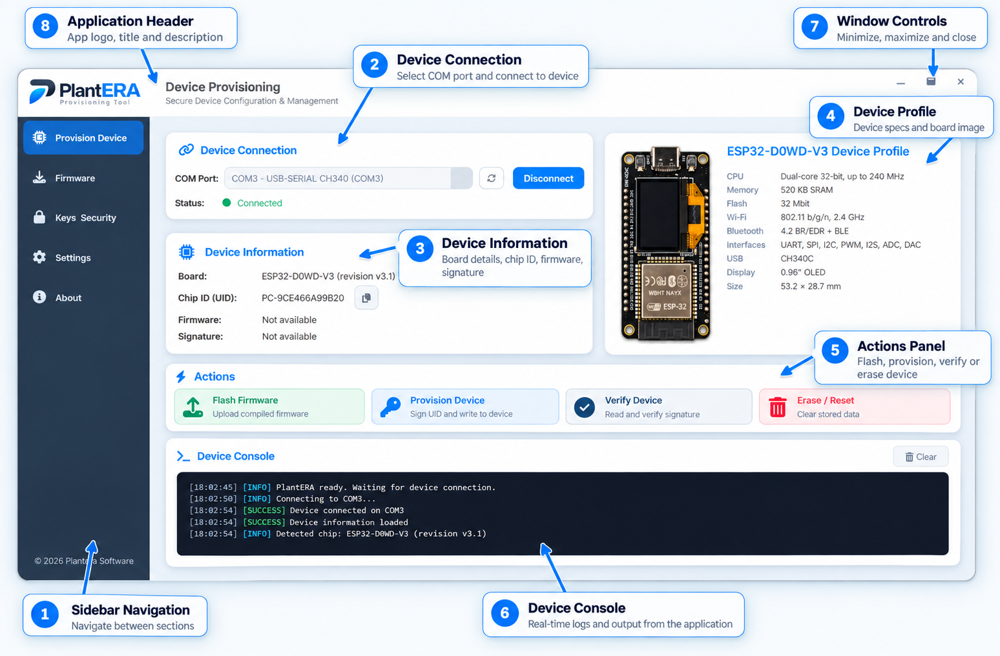

<div align="center">


### ESP32 Provisioning & Device Management

**A modern desktop application for identifying, configuring and securing PlantERA ESP32 devices.**

[](https://www.python.org/)
[](https://doc.qt.io/qtforpython-6/)
[](https://www.espressif.com/)
[](https://github.com/espressif/esptool)
[](https://pyserial.readthedocs.io/)
[](https://pytest.org/)

**Detect · Identify · Provision · Secure**

</div>

---

## Overview

**PlantERA** is a Windows desktop provisioning and device-management application developed for ESP32-based PlantERA hardware.

It provides an intuitive interface for detecting connected devices, identifying their hardware, generating stable device identifiers and preparing devices for secure configuration.

The project uses a modular architecture designed to support future firmware provisioning, cryptographic device authentication and backend registration.

### Key Highlights

- Modern desktop interface built with PySide6
- ESP32 hardware detection using esptool
- Automatic USB and COM port monitoring
- Stable device UID generation
- Hardware profile recognition
- JSON-driven configuration
- Real-time diagnostic console
- Modular and extensible architecture

---

## Application Interface

<div align="center">



*PlantERA device provisioning interface — annotated component overview.*

</div>

### Interface Components

| Component | Description |
|---|---|
| **Sidebar Navigation** | Navigate between provisioning, firmware, security, settings and application information |
| **Device Connection** | Discover available COM ports and connect or disconnect ESP32 devices |
| **Device Information** | Display hardware identification, chip UID, firmware and signature information |
| **Device Profile** | Show the detected board image and hardware specifications |
| **Actions Panel** | Interface for firmware flashing, provisioning, verification and device reset |
| **Device Console** | Display timestamped status messages, connection events and diagnostic logs |
| **Window Controls** | Minimize, maximize, restore and close the application |

---

## Current Features

### Device Detection & Identification

- Automatic COM port discovery
- USB connection monitoring
- ESP32 detection through `esptool`
- Chip model and revision identification
- Hardware-based device UID generation
- Connection and disconnection state management
- Automatic interface reset after device disconnection

### Device Profiles

- Hardware profile matching
- Board images and specifications
- JSON-based hardware configurations
- Support for extending device profiles

### User Interface

- Custom frameless application window
- Sidebar navigation with multiple views
- Responsive layouts and scrollable content
- Independent QSS stylesheets
- Custom application branding
- Visual connection indicators
- Soft shadows and modern component styling
- Real-time device console
- Interactive BOOT detection workflow

### Diagnostics

- Timestamped application messages
- Information, success, warning and error levels
- Connection and device identification logs
- Retry and failure handling
- Clearable console output

---

## Technology Stack

| Technology | Purpose |
|---|---|
| Python 3.13 | Main programming language |
| PySide6 | Desktop application framework |
| QtAwesome | Interface icons |
| esptool | ESP32 communication and detection |
| PySerial | Serial port discovery and management |
| JSON | Application and hardware configuration |
| QSS | Interface styling |
| pytest | Automated testing |
| PyInstaller | Windows executable packaging |

---

## Installation

### Requirements

- Windows 10 or Windows 11
- Python 3.13
- USB-connected ESP32 board
- Compatible USB serial driver

### Clone Repository

```bash
git clone https://github.com/PetarIliev22/PlantERA.git
cd PlantERA
```

### Create Virtual Environment

```powershell
python -m venv .venv
```

Activate the environment:

```powershell
.\.venv\Scripts\Activate.ps1
```

### Install Dependencies

```powershell
python -m pip install -r requirements.txt
```

### Run Application

```powershell
python main.py
```

---
## Project Architecture

```text
PlantERA/
├── assets/
│   ├── fonts/
│   └── img/
│
├── config/
│   ├── config_loader.py
│   └── *.json
│
├── core/
│   └── page_manager.py
│
├── services/
│   └── device_service.py
│
├── styles/
│   ├── provision/
│   └── *.qss
│
├── ui/
│   ├── components/
│   │   ├── provision/
│   │   ├── sidebar.py
│   │   └── toolbar.py
│   ├── dialogs/
│   ├── views/
│   └── main_window.py
│
├── utils/
├── tests/
├── main.py
├── requirements.txt
└── requirements-dev.txt
```

### Architecture Principles

**Separation of Concerns**

Device communication, user interface, navigation and configuration are organized into separate modules.

**Configuration-Driven Design**

Sidebar pages, hardware profiles, UI messages and device actions are configured through JSON files.

**Reusable Components**

Interface elements are implemented as independent PySide6 components.

**Extensibility**

Additional ESP32 boards, hardware profiles and provisioning workflows can be integrated as the project evolves.

---

## Development Status

PlantERA is currently under active development.

| Feature | Status |
|---|---|
| Desktop interface | Implemented |
| Sidebar navigation | Implemented |
| COM port discovery | Implemented |
| ESP32 chip detection | Implemented |
| Device UID generation | Implemented |
| Hardware profiles | Implemented |
| Diagnostic console | Implemented |
| Firmware flashing workflow | Planned |
| Secure provisioning | Planned |
| Signature verification | Planned |
| Device reset workflow | Planned |
| Backend registration | Planned |

Some provisioning action buttons currently represent planned functionality rather than completed device operations.

---

## Testing

Install the development dependencies:

```powershell
python -m pip install -r requirements-dev.txt
```

Run the test suite:

```powershell
python -m pytest tests/
```

---

## Roadmap

- Firmware flashing and version management
- Cryptographic device identity and signing
- Device signature verification
- Secure key management
- Provisioning workflow improvements
- Device configuration and reset operations
- Backend device registration
- Expanded hardware profile support
- Performance and executable size optimization

---

## Project Vision

PlantERA aims to provide a reliable and extensible provisioning environment for ESP32-based hardware.

Its long-term goal is to simplify device preparation, identification, firmware deployment and secure configuration through a unified desktop interface.

---

<div align="center">

**PlantERA — Detect · Identify · Provision · Secure**

Built with Python, PySide6 and ESP32 technology.

© 2026 PlantERA Software

</div>
