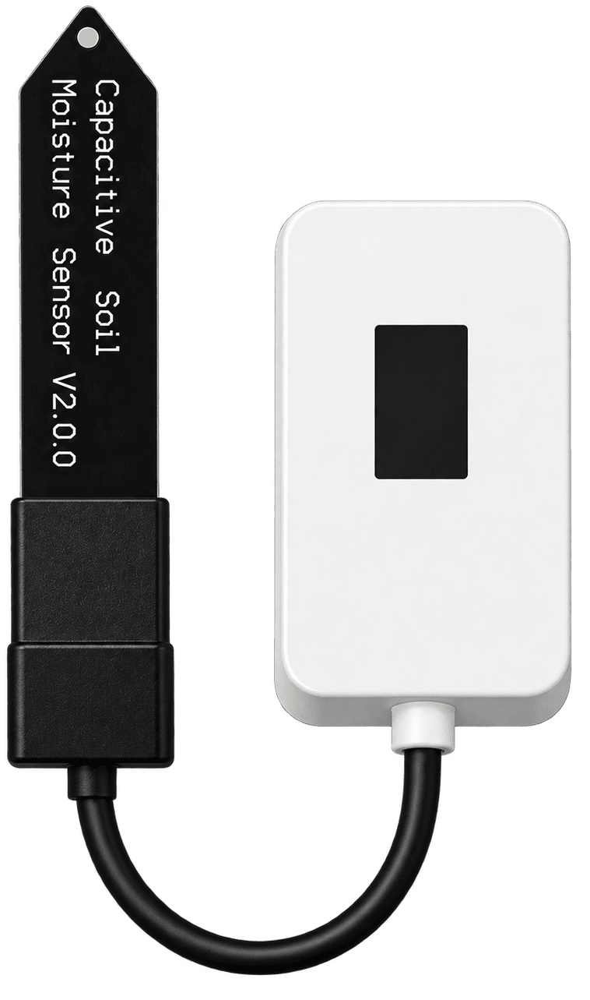

<div align="center">


### ESP32 Provisioning & Device Management

**A modern Windows desktop application for detecting, identifying, and managing PlantERA ESP32 devices.**

[](https://www.python.org/)
[](https://doc.qt.io/qtforpython-6/)
[](https://www.espressif.com/)
[](https://github.com/espressif/esptool)
[](https://pyserial.readthedocs.io/)
[](https://pytest.org/)

**Detect · Identify · Provision · Secure**

</div>

---

## Overview

**PlantERA** is a Windows desktop application for ESP32-based PlantERA hardware. It provides a visual interface for detecting connected boards, identifying hardware, generating stable device identifiers, and preparing devices for future provisioning workflows.

The project uses a modular Python and PySide6 architecture, with separate services for device communication, backend data, and application updates.

### Key Highlights

- Modern desktop interface built with PySide6
- ESP32 hardware detection using esptool
- Automatic USB and COM port monitoring
- Stable hardware-derived device UID generation
- Hardware profile recognition
- JSON-driven configuration
- Real-time diagnostic console
- Automatic application update workflow via GitHub Releases
- Modular architecture designed for future provisioning features

---

## Application Interface

<div align="center">


*PlantERA provisioning interface — annotated component overview.*

</div>

### Interface Components

| Component | Description |
|---|---|
| **Sidebar Navigation** | Navigate between provisioning, firmware, security, settings, and application information |
| **Device Connection** | Discover COM ports and connect to or disconnect from ESP32 boards |
| **Device Information** | Display detected hardware information and a generated device UID |
| **Device Profile** | Show the detected board image and hardware specifications |
| **Actions Panel** | Provide entry points for planned firmware and provisioning operations |
| **Device Console** | Display timestamped connection events and diagnostic messages |
| **Window Controls** | Minimize, maximize, restore, and close the application |

---

## Current Features

### Device Detection & Identification

- Automatic COM port discovery and USB connection monitoring
- ESP32 chip detection through `esptool`
- Hardware identification and stable device UID generation
- Connection and disconnection state management
- Interface reset after device disconnection

### Device Profiles

- Hardware profile matching
- Board images and specifications
- JSON-based hardware configuration
- Extensible profile definitions

### User Interface

- Custom frameless Windows application window
- Sidebar navigation with multiple views
- Scrollable layouts and reusable UI components
- Independent QSS stylesheets and branded assets
- Visual device connection indicators
- Interactive BOOT detection workflow

### Diagnostics

- Timestamped diagnostic messages
- Information, success, warning, and error levels
- Connection and identification logs
- Retry and failure handling
- Clearable diagnostic console

### Application Updates

- Check GitHub Releases for newer versions
- Download the application and updater executables
- Replace the installed executable using a separate updater process
- Restart the application after installation
- Clean up temporary update files

> **Development note:** The update flow does not currently implement cryptographic authenticity verification or automatic rollback. These are planned reliability and security improvements.

---

## Technology Stack

| Technology | Purpose |
|---|---|
| Python 3.13 | Main programming language |
| PySide6 | Desktop UI framework |
| esptool | ESP32 communication and detection |
| PySerial | Serial port discovery |
| Supabase | Backend data source for device models |
| qasync | Integration of asyncio with the Qt event loop |
| JSON | Application and hardware configuration |
| QSS | Interface styling |
| pytest | Automated testing |
| PyInstaller | Windows executable packaging |
| GitHub Actions | Automated release builds |

---

## PlantERA Hardware

PlantERA combines an ESP32-based soil moisture monitoring device with a dedicated Windows desktop application.

<div align="center">



*PlantERA hardware prototype — ESP32 controller, display, and capacitive soil moisture sensor.*

</div>

### Hardware Components

| Component | Description |
|---|---|
| **Microcontroller** | ESP32-based development board |
| **Soil Moisture Sensor** | Capacitive Soil Moisture Sensor V2.0.0 |
| **Display** | Integrated moisture display |
| **Enclosure** | Custom compact housing |
| **Programming** | USB interface |

### Hardware & Software Integration

**PlantERA Monitoring Device**

An ESP32-based hardware prototype designed to measure soil moisture and display readings locally.

**PlantERA Desktop Application**

A Windows application for detecting connected ESP32 boards, identifying hardware, displaying device information, and preparing devices for future configuration and provisioning workflows.

Together, these components form the foundation of the PlantERA hardware and software ecosystem.

> **Development status:** Firmware flashing, secure provisioning, cryptographic device authentication, and signature verification are planned features, not yet completed workflows.

---

## Installation

### Download for Windows

Packaged Windows executables are published on the [GitHub Releases page](https://github.com/PetarIliev22/PlantERA/releases).

### Run from Source

**Requirements:** Windows 10 or Windows 11, Python 3.13, a USB-connected ESP32 board, and a compatible USB serial driver.

**Clone the repository:**

```bash
git clone https://github.com/PetarIliev22/PlantERA.git
cd PlantERA
```

**Create and activate a virtual environment (PowerShell):**

```powershell
python -m venv .venv
.\.venv\Scripts\Activate.ps1
```

**Install dependencies:**

```powershell
python -m pip install -r requirements.txt
```

**Configure the environment:**

Create a `.env` file using `.env_example` as a reference and supply the required Supabase project configuration.

**Run the application:**

```powershell
python main.py
```

---

## Project Architecture

```text
PlantERA/
├── .github/
│   └── workflows/
│       └── release.yml
├── assets/
│   ├── fonts/
│   └── img/
├── config/
│   ├── devices_config/
│   ├── ui_config/
│   ├── config_loader.py
│   └── version.py
├── core/
│   └── page_manager.py
├── services/
│   ├── device/
│   │   └── device_service.py
│   ├── supabase/
│   │   ├── supabase_queries.py
│   │   └── supabase_service.py
│   └── updates/
│       ├── update_cleanup.py
│       ├── update_service.py
│       ├── update_worker.py
│       └── updater.py
├── styles/
│   ├── firmware/
│   ├── provision/
│   └── *.qss
├── ui/
│   ├── common/
│   ├── components/
│   │   ├── firmware/
│   │   └── provision/
│   ├── dialogs/
│   ├── views/
│   └── windows/
├── utils/
├── tests/
├── main.py
├── PlantERA.spec
├── requirements.txt
└── requirements-dev.txt
```

### Architecture Principles

**Separation of Concerns** — Device communication, backend access, updates, UI, and configuration are organized into separate modules.

**Configuration-Driven Design** — Hardware profiles, interface messages, and device actions are configured using JSON files.

**Reusable Components** — Interface sections are implemented as independent PySide6 components.

**Extensibility** — The architecture supports additional ESP32 boards, device profiles, and future provisioning workflows.

---

## Development Status

PlantERA is currently under active development.

| Feature | Status |
|---|---|
| Desktop interface and navigation | Implemented |
| COM port discovery and USB monitoring | Implemented |
| ESP32 chip detection | Implemented |
| Device UID generation | Implemented |
| Hardware profiles | Implemented |
| Diagnostic console | Implemented |
| Device model data from Supabase | Implemented |
| Application update workflow | Implemented |
| Firmware flashing workflow | Planned |
| Secure device provisioning | Planned |
| Device signature verification | Planned |
| Device reset workflow | Planned |
| Backend device registration | Planned |
| Update authenticity verification and rollback | Planned |

Some provisioning buttons currently represent planned functionality rather than completed device operations.

---

## Testing

Install the development dependencies:

```powershell
python -m pip install -r requirements-dev.txt
```

Run the test suite:

```powershell
python -m pytest tests/
```

Tests cover selected configuration, device-profile, device-service, path, and update-service behaviors. A successful automated test run does not replace hardware and packaged-update testing on Windows.

---

## Roadmap

- Firmware flashing and version management
- Cryptographic device identity and signing
- Device signature verification
- Secure key management
- Provisioning workflow improvements
- Device configuration and reset operations
- Backend device registration
- Update authenticity verification and rollback
- Expanded hardware profile support
- Performance and executable-size optimization

---

## Project Vision

PlantERA aims to provide a reliable and extensible provisioning environment for ESP32-based hardware. Its long-term goal is to simplify device preparation, identification, firmware deployment, and secure configuration through a unified desktop interface.

---

<div align="center">

**PlantERA — Detect · Identify · Provision · Secure**

Built with Python, PySide6, and ESP32 technology.

© 2026 PlantERA Software

</div>
